# WFM Operations App

A web application for a workforce-management (WFM) / real-time-management (RTM) team, built on **Google Apps Script** with **Google Sheets** as the database. It replaces spreadsheets and email threads with one place for shift handovers, operational tickets, report automation and live performance dashboards.

> **Status:** in use by one operations team (October 2026) and actively developed.
> **Note on this repository:** screenshots use **synthetic demo data**. Client names, hosts and internal ids in the source are replaced with placeholders (`your-tenant`, `YOUR_*`). See [About the screenshots](#about-the-screenshots).

---

## Contents

- [The problem](#the-problem)
- [What the app does](#what-the-app-does)
- [Screenshots](#screenshots)
- [Architecture](#architecture)
- [Security model](#security-model)
- [Tech stack](#tech-stack)
- [Repository layout](#repository-layout)
- [Setup and deployment](#setup-and-deployment)
- [Limitations and known issues](#limitations-and-known-issues)
- [Roadmap](#roadmap)
- [About the screenshots](#about-the-screenshots)

---

## The problem

Performance reporting depended on Excel workbooks fed by exports that were downloaded by hand from several vendor portals (a WFM platform, an interpretation-services portal and a BI tool), then cleaned and pasted in. Shift handovers and operational requests needed a shared record of who owned what and whether a shift was closed cleanly.

The app's goals, as reflected in the code:

- one checklist per shift with clear ownership and a locked, auditable shift close;
- tickets with an owner, priority, due date and history;
- report fetching and cleaning automated end to end, using the same rules as the original workbook pipeline;
- dashboards that refresh from the data sheets, so nobody has to rebuild them.

## What the app does

| Module | What it is for | Highlights |
|---|---|---|
| **RTM Handover** | Per-shift checklist (Morning / Mid / Overnight) built from a master task list | Multi-person assignment, "received by" hand-off, comments with file attachments, `@mention` emails, **End Shift** that locks the shift once no task is pending (Managers/Admins can reopen with a reason) |
| **Tickets** | Lightweight operational ticketing | Types (Issue / Task / Flags), priority, due date, CC, public vs. private, full activity history and comments, email notifications with opt-out, role-based permissions per action |
| **Personal Assistant** | Private to-do list + AI chat | To-do items stored per user (not in the shared sheet); AI assistant that tries an ordered list of providers (OpenAI, Anthropic, Gemini or any OpenAI-compatible API) and skips one that is rate-limited or down |
| **Reporting** | Report tools and raw-data extraction | **Report tools**: the "Voyce Performance Report" fetches two vendor reports for a date range (or accepts uploaded CSV/XLSX), recognises each file by its columns, cleans and de-duplicates, and exports CSV/XLSX built in the browser. **Extract Data**: download the raw datasets behind each dashboard as CSV or Excel, read live from the source sheets, without opening Google Sheets; role-checked, read-only, and verified against reloads during the download |
| **Dashboards** | Live KPI dashboards that replaced Excel workbooks | **Voyce Performance** (productivity, CSR, missing calls, offline codes), **Adherence** (schedule adherence from the WFM platform, target 96%), **MVCC Performance** (productivity, CSR, abandoned and short calls), **ACW Performance** (after-call work per accepted call against a 10-second target). Filters, drill-down tabs, highlights, CSV export, data-health checks |
| **Admin tools** | Run from the Apps Script editor | Schema bootstrap, sharing report, link-sharing lockdown, plain-text hardening of user-typed columns, duplicate-row repair, cache invalidation |

Roles: **Admin**, **Manager**, **RTM** and **Operations** (read-only for most modules). Roles live in a `Roles` sheet and are checked on the server for every call.

## Screenshots

### RTM Handover
A shift's checklist with assignees, hand-off ("Received by"), status and per-task comments/attachments. The strip at the top tracks shift progress; **End Shift** stays disabled while any task is pending.

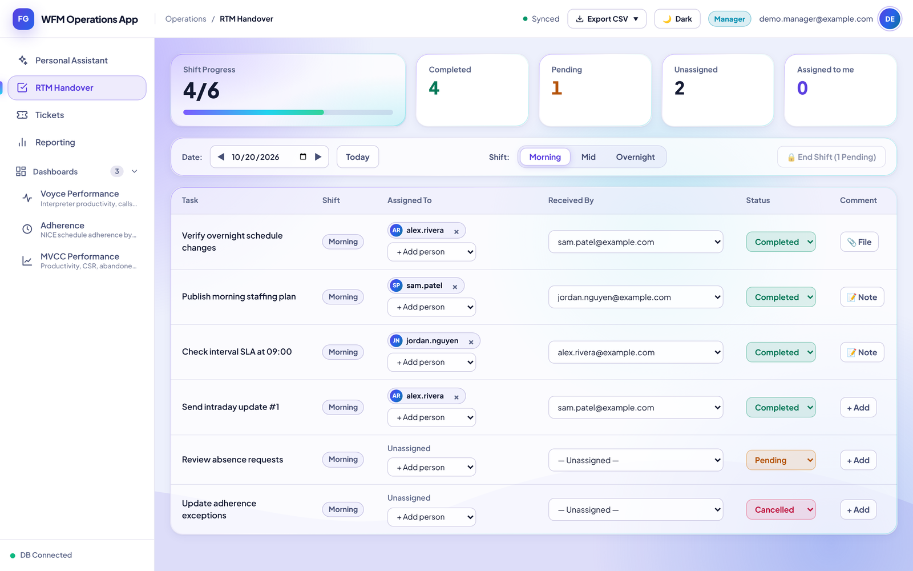

### Tickets
Ticket list with search, scope filters (assigned to me / created by me / CC'd), priority and due dates.

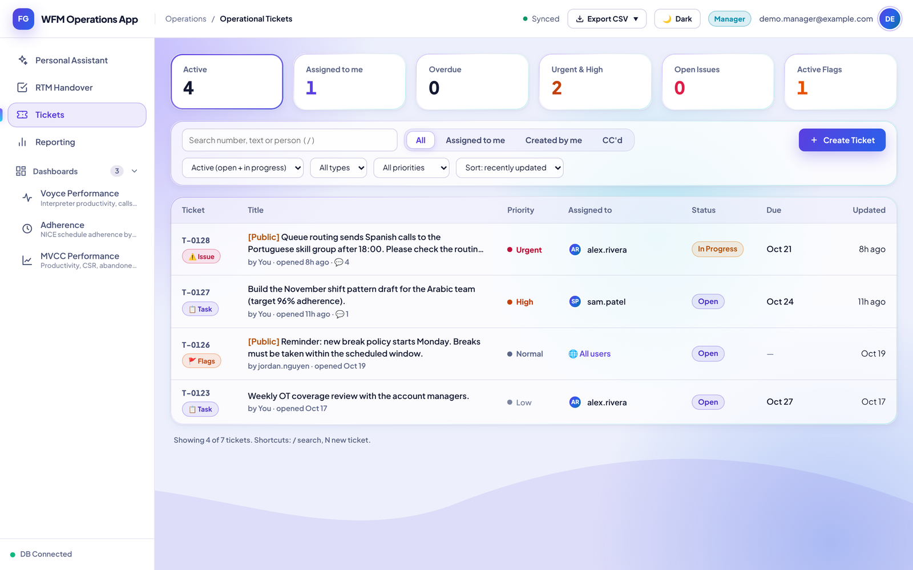

Ticket detail panel: status, priority, due date, assignees, CC, public/private visibility and the email-notification switch.

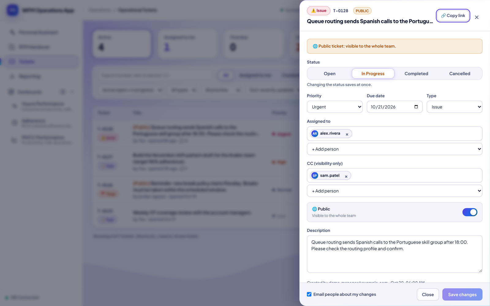

### Personal Assistant
Private to-do list (only the signed-in person can see it) next to the AI assistant.

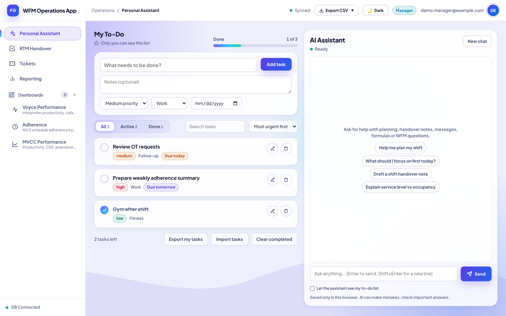

### Voyce Performance dashboard
KPI cards against targets, auto-generated highlights (strongest team, most room to improve, where to focus), totals and a daily trend. Every number is a ratio of sums, matching the Excel workbook it replaced.

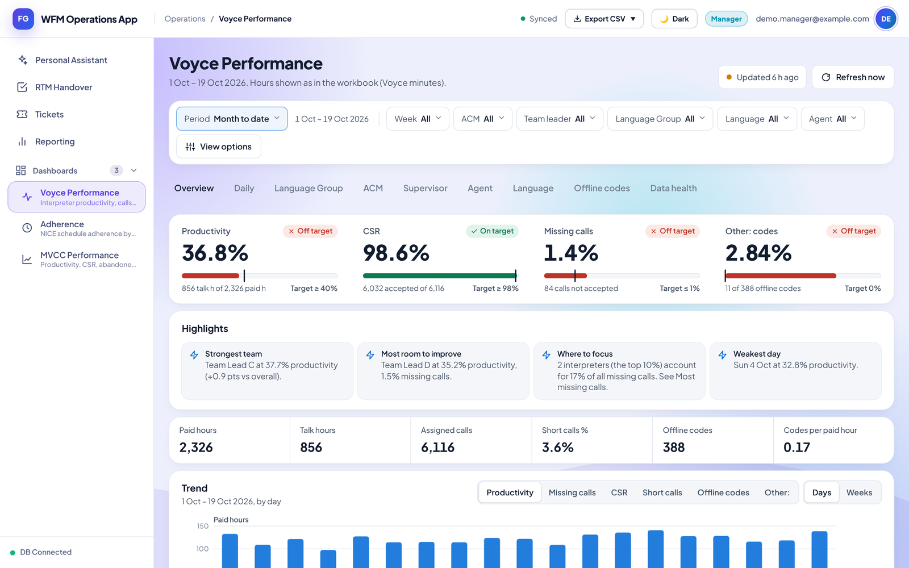

The same dashboard in dark mode:

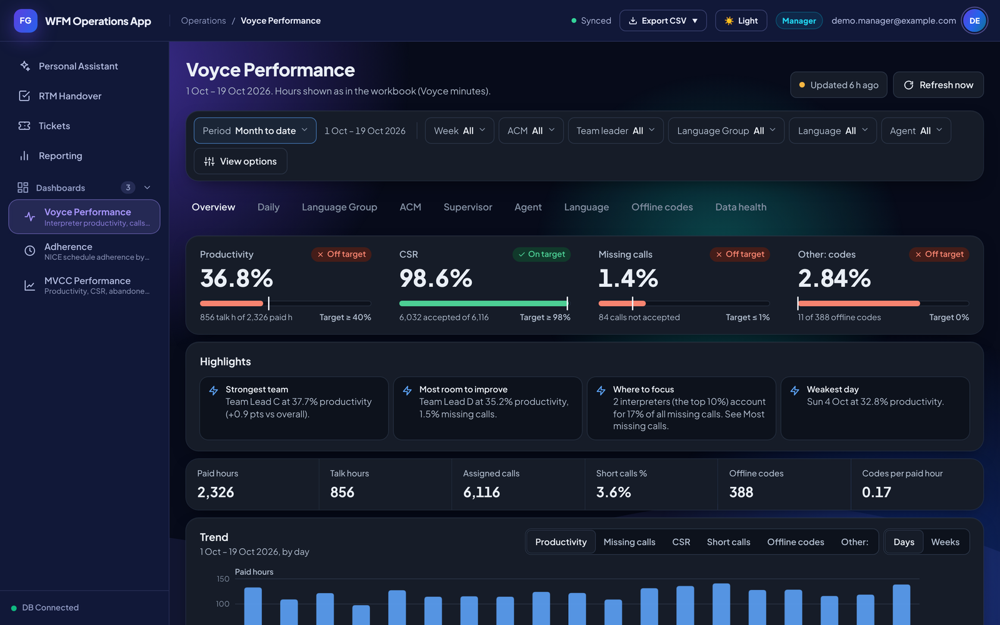

### Adherence dashboard
Schedule adherence for the month to date, split by queue, with sparklines and highlights.

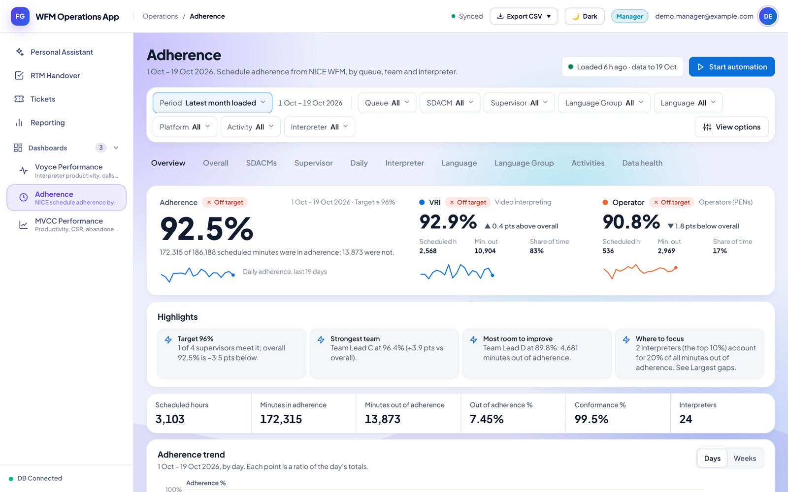

Drill-down tabs reproduce the original workbook sheet by sheet, e.g. adherence per supervisor with in-cell bars against the 96% target:

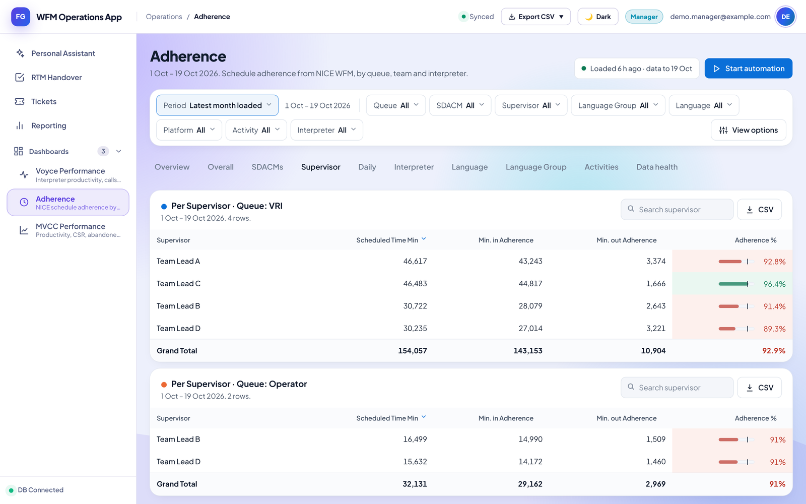

### MVCC Performance dashboard
Productivity, CSR, abandoned-call and short-call rates with targets and trends.

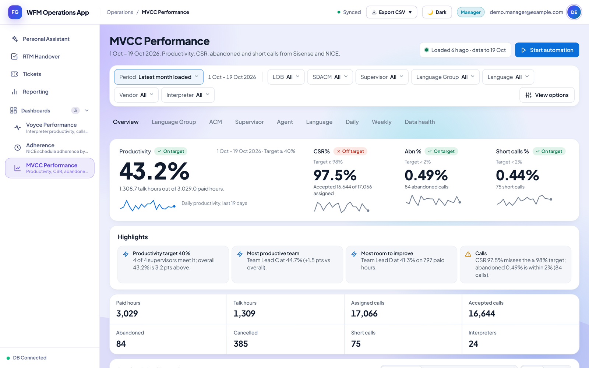

### ACW Performance dashboard
After-call work per accepted call against the 10-second target, combining call events from the BI tool with ACW time from the WFM platform. KPI cards, highlights, a daily trend split by queue, and breakdowns by manager, supervisor and agent.

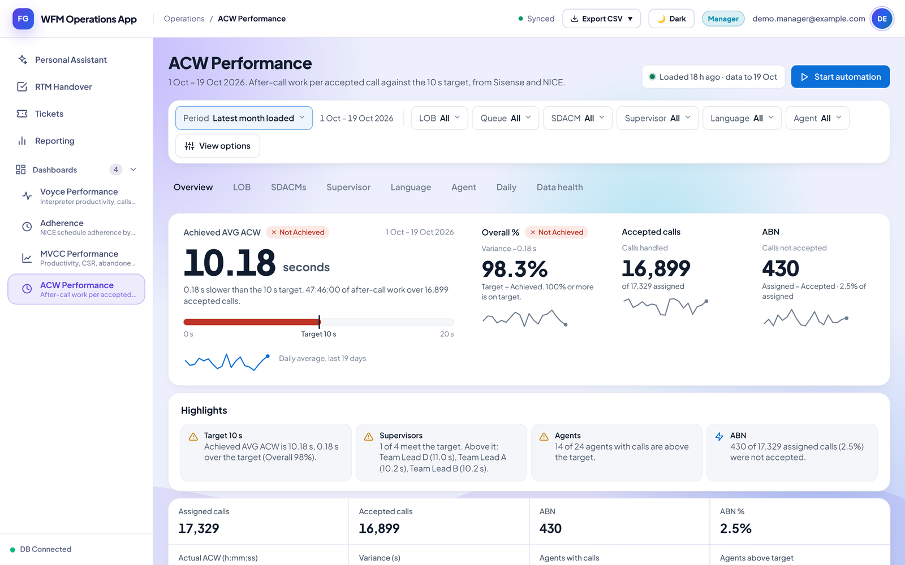

### Reporting: Extract Data
Every dashboard's raw data, one click away. Each card lists the datasets behind a dashboard; only people whose role can open that dashboard see it.

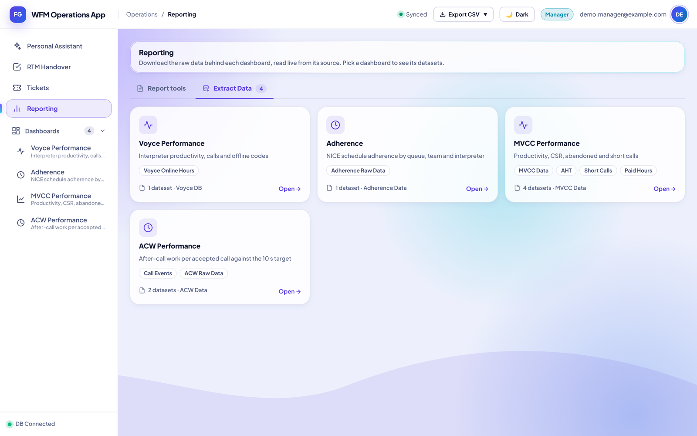

Inside a dashboard: download everything as one Excel workbook (one sheet per dataset, with the source's headers and number formats), or each dataset as CSV or Excel, with a live preview of the first rows.

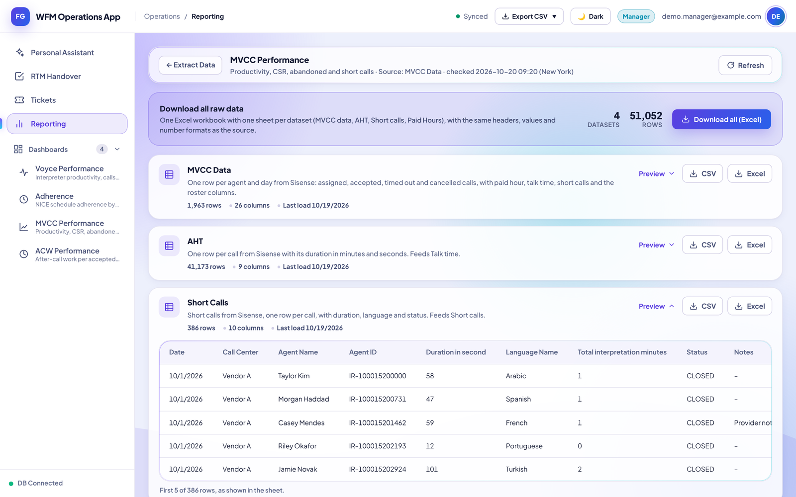

### Full dashboard overviews (dark mode)

The complete Overview tab of each dashboard, top to bottom: KPI cards, highlights, totals, trend chart, breakdowns by manager, team, interpreter and language, and heatmaps by team and day.

<table>
  <tr><th>Voyce Performance</th><th>Adherence</th></tr>
  <tr>
    <td width="50%"><a href="docs/images/dashboard/dashboard-voyce-full-dark.png">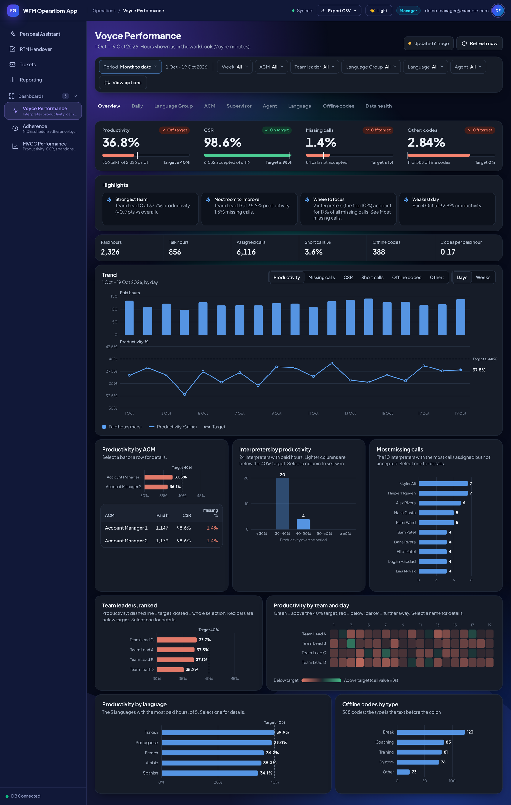</a></td>
    <td width="50%"><a href="docs/images/dashboard/dashboard-adherence-full-dark.png">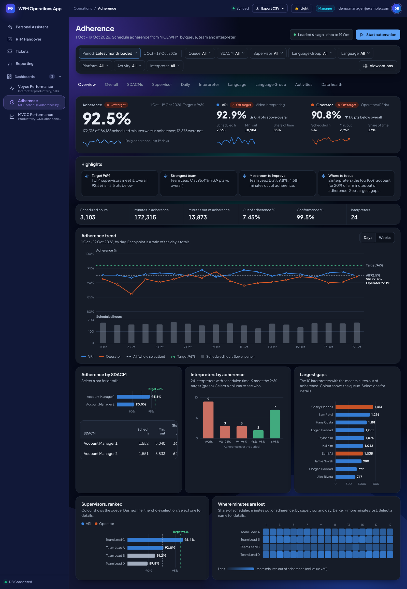</a></td>
  </tr>
  <tr><th>MVCC Performance</th><th>ACW Performance</th></tr>
  <tr>
    <td width="50%"><a href="docs/images/dashboard/dashboard-mvcc-full-dark.png">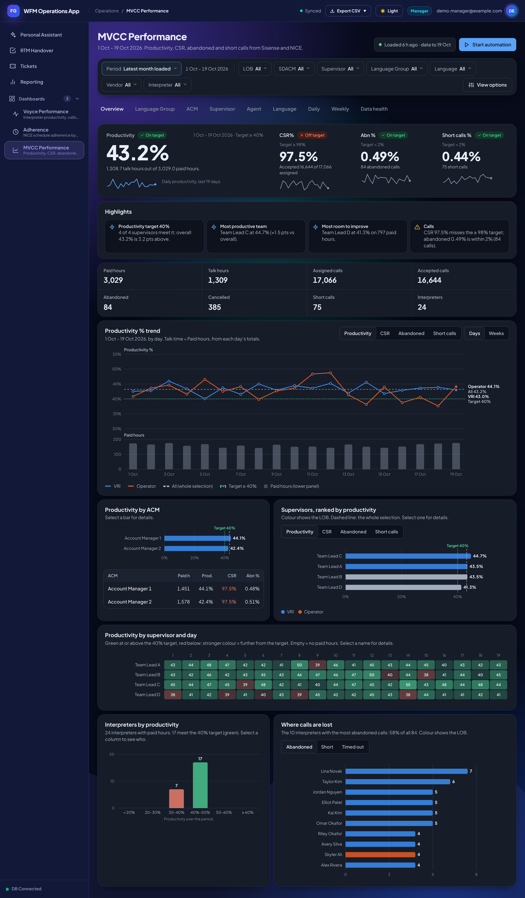</a></td>
    <td width="50%"><a href="docs/images/dashboard/dashboard-acw-full-dark.png">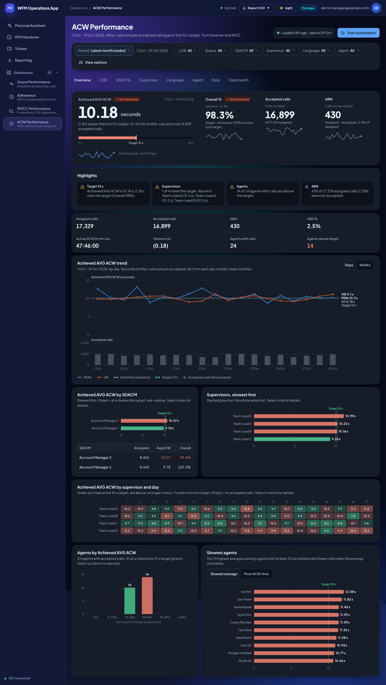</a></td>
  </tr>
</table>

Select an image to open it at full size.

## Architecture

The app runs as **two Apps Script projects**, so that the database spreadsheet does not have to be shared with users while email still goes out from each user's own account.

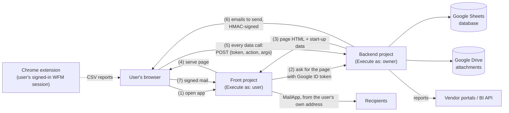

1. **Front project** (`src/front/`, *Execute as: User accessing*). Holds no data. It obtains a Google-signed identity token for the visitor, asks the backend for the page, injects the API config, and sends emails that the backend has signed. Each person's private to-do list lives in this project's per-user storage.
2. **Backend project** (`src/backend/`, *Execute as: Me*). The only code that touches the spreadsheet and Drive. `doPost` verifies the identity token with Google (`oauth2.googleapis.com/tokeninfo`), checks audience, issuer and email verification, looks up the caller's role and runs the requested function only if it is on an allow-list for that role (`API_FUNCS_` in `api.js`). Writes are recorded in an **Audit Log** sheet.
3. **API shim** (`ApiShim.html`). Replaces `google.script.run` in the browser with a `fetch` to the backend, so the page code did not have to change when the app moved to the two-project design. It refreshes the identity token five minutes before expiry.
4. **WFM NICE Connector** (`extension/wfm-nice-connector/`, Chrome Manifest V3). The WFM platform offers no API access, so this extension runs report jobs in the user's own signed-in session: it opens the report form in a background tab, fills it, presses Generate, waits for the report and returns the CSV to the app page. Jobs are data sent by the app (one definition per report), so a new report needs no extension change. Each app origin must be approved once by the user; the extension only opens the WFM host, uses read-only GETs for page reads and stores no passwords. See [`HOW_TO_ADD_A_NICE_REPORT.md`](extension/wfm-nice-connector/HOW_TO_ADD_A_NICE_REPORT.md).

Data and performance patterns used in the code:

- **Sheets as a database** with fixed schemas created on first run (`initializeDatabase_`) and versioned migrations for tickets.
- **Day bundle**: one call returns all three shifts for a date; only the date column is scanned before reading matching rows (`Daybundle.js`).
- **Mutation clocks** in Script Properties let clients poll cheaply for changes (`checkSystemSync`) and make cache keys self-invalidating.
- **CacheService** for roles, master tasks and dashboard payloads (gzip + base64 in chunks to fit the 100 KB entry limit).
- **LockService** around every write; emails and Drive uploads happen outside the lock.
- **Columnar dashboard payloads**: the server sends compact agent × day facts once; all filtering, grouping and KPI maths run in the browser, so a filter click makes no server call.
- **Self-repairing sheet formulas**: dashboard data sheets use one `ARRAYFORMULA` per column in row 1; loaders rewrite them on every run and never write into formula columns.

More detail: [docs/ARCHITECTURE.md](docs/ARCHITECTURE.md).

## Security model

- Identity comes only from a Google-signed ID token (backend) or `Session.getActiveUser()` (front); never from data the browser sends.
- Every public server function checks the role itself; the API allow-list is a second, central gate. The browser is never the security boundary.
- The spreadsheet and attachments folder are not shared with users (tools in `Hardening.js` report and remove sharing).
- User-typed columns are formatted as plain text so input such as `=IMPORTRANGE(...)` cannot run as a formula; CSV exports prefix formula-like cells.
- Attachment records are rebuilt from known fields only; upload size and count are enforced on the server.
- Credentials for vendor portals, AI providers and the mail-signing key are stored in **Script Properties**, never in code. Audit-log entries hide argument fields named like keys, tokens or passwords.
- Emails are queued by the backend, HMAC-signed with a per-request nonce and 15-minute expiry, and the front sends them only for the matching signed-in user.

## Tech stack

| Area | Used in this project |
|---|---|
| Language | JavaScript (Apps Script V8 runtime), HTML, CSS |
| Platform | Google Apps Script web apps (two projects), `clasp` for local development |
| Google services | SpreadsheetApp, DriveApp, MailApp, CacheService, LockService, PropertiesService, HtmlService, UrlFetchApp; advanced services Drive v3, Sheets v4, Gmail v1 |
| Data | Google Sheets (database and report sheets with `ARRAYFORMULA` / `IMPORTRANGE`) |
| Integrations | Vendor report portal (session login, run → poll → CSV download), BI REST API (JAQL queries), WFM platform via the companion Chrome extension, LLM APIs (OpenAI, Anthropic, Gemini, OpenAI-compatible) |
| Browser extension | Chrome Manifest V3: service worker, content script bridge (`window.postMessage`), `chrome.scripting`, `chrome.storage` |
| Front end | Vanilla JavaScript, hand-built canvas/SVG charts, a design-token stylesheet with light/dark themes. No front-end framework and no external scripts |

Size: about 10,600 lines of server-side JavaScript, 13,300 lines of HTML/CSS/JS front end and 600 lines for the browser extension.

## Repository layout

```
.
├── README.md
├── docs/
│   ├── ARCHITECTURE.md
│   └── images/dashboard/        screenshots (synthetic data)
├── src/
│   ├── backend/                 Apps Script backend project (clasp rootDir)
│   │   ├── appsscript.json
│   │   ├── .clasp.json.example
│   │   ├── Code.js  api.js  Auth.js  Daybundle.js  Tickets.js  Notify.js ...
│   │   ├── Dashboards.js  Dash_*.js  Adherence.js  Mvcc.js  Acw.js  Voyceonlinehours.js
│   │   ├── Reporting.js  Extract.js  ReportAutomation*.js  Assistant.js  Setup.js  Hardening.js
│   │   └── Index.html  Styles.html  ToDo.html  Tickets_HTML.html  Dash_*_HTML.html ...
│   └── front/                   Apps Script front project
│       ├── appsscript.json
│       ├── Bridge.gs
│       └── PersonalTodo.gs
├── extension/
│   └── wfm-nice-connector/      Chrome extension (Manifest V3)
└── tools/
    └── screenshot-harness/      renders the real pages with synthetic data (Node + Playwright)
```

## Setup and deployment

You need two Google Apps Script projects, a Google account that owns the database spreadsheet, and [`clasp`](https://github.com/google/clasp).

**Backend**

1. Create a spreadsheet; open *Extensions → Apps Script*. Copy `src/backend/.clasp.json.example` to `.clasp.json`, set your `scriptId`, then `clasp push`.
2. In the editor run `setupDeployment()` (creates the sheets and the attachments folder). Add yourself to the `Roles` sheet as `Admin`.
3. Deploy as a web app: *Execute as: Me*, *Who has access: Anyone*. Every request still needs a valid Google ID token.
4. Run `apiSetupMailKey()` once; it creates `MAIL_SIGNING_KEY` in Script Properties.

**Front**

5. Create a standalone Apps Script project from `src/front/` (`Bridge.gs`, `PersonalTodo.gs`, `appsscript.json`). Deploy as a web app: *Execute as: User accessing the web app*.
6. In the front project's Script Properties set `BACKEND_URL` (backend `/exec` URL) and `MAIL_SIGNING_KEY` (same value as the backend).
7. Run `showMyAudience()` in the front project and put the printed value into the backend's `API_ALLOWED_AUD` Script Property. Run `checkFrontSetup()` to confirm.

**Browser extension** (for the Adherence, MVCC and ACW automations): set your WFM host in `extension/wfm-nice-connector/manifest.json` and `background.js` (replace `your-tenant`), then load the folder in Chrome via *Extensions → Developer mode → Load unpacked*.

**Optional modules** (each needs its own Script Properties and data spreadsheet): report automation (`VOYCE_USERNAME`, `VOYCE_PASSWORD`, `SISENSE_USERNAME`, `SISENSE_PASSWORD`), dashboards (`VOH_SPREADSHEET_ID`, `ADH_SPREADSHEET_ID`, `MVCC_SPREADSHEET_ID`, `ACW_SPREADSHEET_ID`), AI assistant (providers are added by an Admin in the app).

> These steps are reconstructed from the code's own setup functions and comments. They have not been re-run from scratch for this repository.

## Limitations and known issues

- **Apps Script quotas**: 6-minute execution limit (long loads are chunked and resumable), daily `MailApp` quota per user, 100 KB per cache entry.
- **Sheets as a database** suits a single team, not a large organisation: every write goes through one script-wide lock, and there are no transactions or indexes.
- **Vendor integrations depend on vendor web pages and dashboards** (session login, report IDs, widget definitions); a vendor-side change can break a fetch. The WFM platform has no API access, so its reports come through the browser extension, which has to be installed on each user's Chrome.
- **No automated test suite in this repository.** Verification so far has been manual, against the original Excel outputs.
- `Code.js`'s header comment still describes the earlier single-project deployment; `api.js` describes the current one.
- Attachment access checks fall back to matching the parent folder **name**; matching the configured folder id only would be stricter.

## Roadmap

- Move the dashboards into the company's main web application, keeping the Google Sheets data sources and handing the automation scripts over to the team that runs them.
- Make the browser extension reusable for further WFM reports.
- Add unit tests for the pure functions (dashboard aggregation, report cleaning, date handling) using the Node sandbox in `tools/screenshot-harness/`.

## About the screenshots

The live app cannot be shown: it holds real employee names, emails and client performance figures. The screenshots were produced by `tools/screenshot-harness/`, which:

1. loads the **real backend source** into a Node sandbox and runs the app's own aggregation functions (`VOHD_aggregate_`, `ADHD_aggregate_`, `MVD_aggregate_`, `ACD_aggregate_`) over **synthetic raw rows**;
2. assembles the **real front-end pages** the way `HtmlService` does and replaces `google.script.run` with a stub that returns those payloads;
3. renders them in headless Chromium (1440 × 900).

All people, emails and numbers in the images are invented.

## License

No license has been chosen yet. All rights reserved until one is added.
